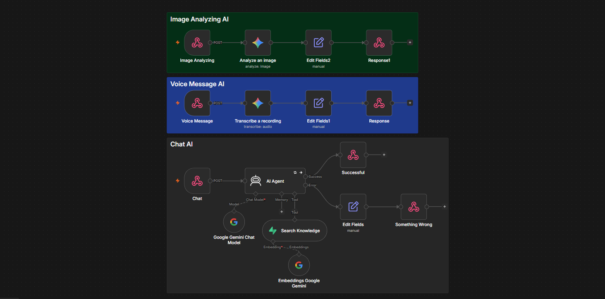
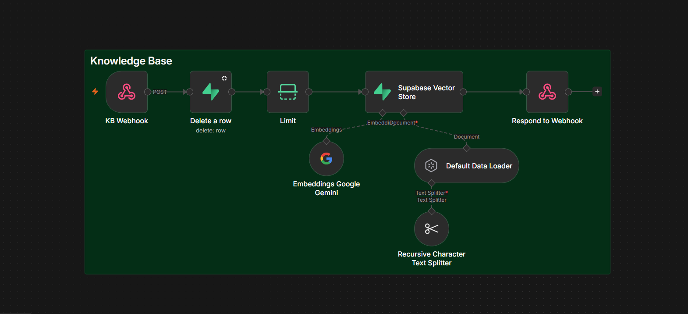

# Atelier

A branded AI chat for small businesses. It answers from the business's own knowledge (menu, hours,
policies), takes voice notes and images, and runs either as a page or as a widget that drops onto any
website with one line of code.

```
visitor's browser / website widget
        |
   Flask app (app.py)  --->  n8n webhooks  --->  Gemini
        |                          |
        +--------> Supabase (pgvector: what the assistant knows)
```

The browser only ever talks to the Flask app. The n8n addresses, the n8n secret and the database key never
reach the page.

## What it does

- Chat with markdown, tables, voice notes (transcribed by Gemini) and image analysis.
- Answers only from the client's knowledge base, via a Search Knowledge tool in n8n.
- One JSON file per client in `brands/` sets the look, wording, colours, fonts and personality.
- Admin page (`/admin`): see, edit, replace and delete what the assistant knows, with a test chat beside it
  and a live 20-point security checklist. Upload PDF, Word, text, Markdown or CSV, or paste text.
- Embeddable widget (`widget.js`): a floating button that opens the client's chat on their own site.

## Layout

| Path | What it is |
|---|---|
| `app.py` | Flask server: pages, the assistant proxy, the admin API, the security checklist |
| `Atelier.html` | The chat page (also the compact view inside the widget) |
| `admin.html` | Knowledge admin page |
| `widget.js` | The embeddable widget |
| `embed-demo.html` | A mock client website with the widget installed |
| `brands/*.json` | One file per client |
| `db/schema.sql` | Supabase tables, search function and view |
| `n8n/` | Exported n8n workflows |
| `docs/` | Screenshots of the n8n workflows, used in this README |
| `tools/check_secrets.py` | Blocks commits that contain keys or tunnel addresses |
| `tools/make_client_key.py` | Makes a client their own key for the admin page |
| `tools/ship.py`, `ship.cmd` | One command to commit and push |
| `.githooks/pre-commit` | Runs the secret scan on every commit |

## Run it locally (Windows PowerShell)

You need Python 3.10+, an n8n instance with the workflows below, and a Supabase project.

1. In the Supabase SQL editor, run `db/schema.sql`.
2. Install, then set the settings. Never put a key in a file.

```powershell
py -m venv .venv
.\.venv\Scripts\Activate.ps1
pip install -r requirements.txt

setx ATELIER_ADMIN_KEY "a-long-random-string-of-24-or-more-characters"
setx SUPABASE_SERVICE_KEY "the service_role / secret key from Supabase"
setx N8N_BASE_URL "https://your-n8n-address/webhook"
setx N8N_AUTH "X-Atelier-Key:another-long-random-string"
setx ATELIER_DEBUG 1
```

3. Open a NEW terminal (`setx` only reaches windows opened afterwards), then:

```powershell
py app.py
```

The startup text lists every address and a security summary. `ATELIER_DEBUG=1` gives auto-reload and
belongs on your PC only.

| Address | What |
|---|---|
| `http://atelier.localhost:5000/c/<brand>` | A client's chat |
| `http://atelier.localhost:5000/admin` | Knowledge admin and security checklist |
| `http://atelier.localhost:5000/embed-demo` | The widget on a sample website |

`*.localhost` addresses resolve to your own machine in Chrome, Edge and Brave. Windows PowerShell does not
resolve them, so use `127.0.0.1:5000` for command-line tests.

## Settings

| Variable | Needed | Purpose |
|---|---|---|
| `ATELIER_ADMIN_KEY` | yes | Your own key for the admin page (24+ characters). Sees every client. Must equal the KB Ingest Header Auth value. |
| `SUPABASE_SERVICE_KEY` | yes | Lets the server list, read and delete knowledge. |
| `N8N_BASE_URL` | yes | Base address of your n8n webhooks, ending in `/webhook`. |
| `N8N_AUTH` | yes | `Name:value` header that the chat, voice and image webhooks require. |
| `ATELIER_DEBUG` | dev only | `1` turns on the debugger and auto-reload. Never on a public server. |
| `ATELIER_TRUST_PROXY` | behind a proxy | `1` makes the app believe `X-Forwarded-For` and `X-Forwarded-Proto`. |
| `ATELIER_DAILY_CAP` | no | App-wide cap on AI requests per day. Default 1500. |
| `ATELIER_SITE_URL` | public host | The site's public address. |
| `SUPABASE_URL` | no | Defaults to the project set in `app.py`. |

## n8n workflows

| Webhook path | Does | Set up |
|---|---|---|
| `atelier` | Chat: AI Agent with the Search Knowledge tool | Header Auth, Ignore Bots off |
| `atelier-transcribe` | Voice note to text (Gemini, audio) | Header Auth, Ignore Bots off |
| `atelier-image` | Answer about an image (Gemini) | Header Auth, Ignore Bots off |
| `atelier-kb` | Save a document: delete old chunks, split, embed, store | Header Auth `X-Admin-Key` |

For the first three, use one Header Auth credential whose Name and Value match `N8N_AUTH`. Turn **Ignore Bots**
off (n8n treats Python scripts as bots and answers 403) and remove the CORS option: only the server calls them.
In the chat workflow, the agent's system message and the Search Knowledge filter read `persona` and `client`,
which the server adds from the brand file. They never come from the browser.

Export each workflow from n8n (three dots menu, Download) into `n8n/`. Unpin test data first, since pinned
data is included in the export.

### How the workflows look

**Atelier Chat** holds three flows, one group each. Chat: the AI Agent answers using the Search Knowledge tool
(a Supabase vector search with Gemini embeddings), and if the agent fails a separate branch returns a friendly
"Something Wrong" reply instead of an error. Voice Message: Gemini transcribes the recording. Image Analyzing:
Gemini answers about the picture.



**Knowledge Base** (the KB Ingest workflow) saves a document. The webhook receives it, Delete a row removes the old
chunks for that client and document, Limit keeps a single item so the text is stored once, and the Supabase Vector
Store splits it (Recursive Character Text Splitter), embeds it with Gemini and stores the chunks. Respond to
Webhook then answers `ok`.



## A brand file

```json
{
  "name": "Casa Atelier",
  "wordmark": "Casa Atelier",
  "initial": "C",
  "title": "Casa Atelier - Ask us anything",
  "heroTitle": "What can we *tell* you?",
  "subtitle": "Opening hours, the menu, reservations.",
  "placeholder": "Ask about our menu or hours...",
  "teaser": "Questions about the menu? Ask us.",
  "suggestions": ["What are your opening hours?", "Where can I park?"],
  "theme": { "light": { "accent": "#b4501f" }, "dark": { "accent": "#e0813f" } },
  "allowedOrigins": ["https://www.the-restaurant.com"],
  "client": "casa-demo",
  "persona": "You are the assistant for ..."
}
```

`client` and `persona` stay on the server. `allowedOrigins` lists the websites allowed to embed this client's
chat. Optional: `fonts` (`url`, `serif`, `sans`), `dot`, and light/dark `bg`, `surface`, `ink`, `muted`.
The file name is the address: `brands/casa-atelier.json` is `/c/casa-atelier`. There is no default brand.

## Put it on a website

```html
<script src="https://YOUR-HOST/widget.js" data-brand="casa-atelier" async></script>
```

The host must be public HTTPS (the microphone needs it). Add `data-position="left"` to move it, or call
`AtelierWidget.open()` from your own button.

## Security

The admin page shows a live 20-point checklist (verified, fix this, your move). What the code does:

- Secrets and addresses live in environment variables only. A pre-commit scan stops any commit that contains a
  key or a tunnel address. Turn it on once per copy of the repo: `git config core.hooksPath .githooks`
- Admin routes need a key. Your admin key sees every client. A client's own key (below) sees and edits only that
  client's documents, and the server enforces it on every call. Eight wrong keys lock an address for ten minutes.
- Public calls (chat, voice, image) are limited per visitor, capped per day for the whole app, and refused
  when they come from another website's browser.
- Only listed fields reach n8n, messages are length-capped, and uploads are checked by file signature, not name.
- Visitors only ever see generic errors. Addresses and stack traces stay in the server log.
- Security headers on every response, framing limited to each client's `allowedOrigins`, and a strict content
  policy in report-only mode (browsers list anything it would block in the console).
- No cookies are used, so there is nothing for CSRF to ride on.

Still yours to do: HTTPS and `ATELIER_TRUST_PROXY=1` on a public host, a budget alert at Google, and CORS off on
the n8n webhooks. For the strongest split between clients, give each their own Supabase project.

## Give a client their own key

```powershell
py tools\make_client_key.py casa-atelier
```

It prints a key once and saves only its SHA-256 hash in `brands/casa-atelier.json` (safe to commit). Send the
client the key and `<your-site>/admin`. Signed in with it, they see their own documents and a test chat, with the
client name locked, and no security checklist. `--rotate` replaces a key, and the old one stops working.

## If a key is lost or stops working

**A client lost their key.** It can't be looked up: only a one-way hash is stored, so nobody, including you, can
read it back. Make a new one:

```powershell
py tools\make_client_key.py casa-atelier --rotate
```

Send the client the new key. The old one stops working at once. Then publish the updated brand file
(`.\ship "Rotate casa-atelier key"`, and copy it to the server if the site is hosted). It does not need a restart.

**You lost your admin key.** It is stored in Windows, so copy it back to the clipboard (nothing is printed):

```powershell
[Environment]::GetEnvironmentVariable("ATELIER_ADMIN_KEY","User") | Set-Clipboard
```

Paste it into the key box on the admin page. If that prints an error or pastes nothing, it was never saved. Make a
new one and put the same value in three places:

```powershell
$k = [guid]::NewGuid().ToString("N") + [guid]::NewGuid().ToString("N"); $k | Set-Clipboard
setx ATELIER_ADMIN_KEY $k
```

1. n8n: open the KB Ingest workflow, edit the Header Auth credential on its webhook (Name `X-Admin-Key`), paste the
   value, and publish.
2. Open a new terminal and restart `py app.py`.
3. Paste it into the admin page.

On a hosted server the key is a setting of the server, not a file in the repo. Change it there. Keep a copy in a
password manager, and never paste a key into a chat, a screenshot or a file you commit.

**The page says the key isn't right, and you are sure it is.** Check these in order:

- The key was rotated since you last used it: a new key replaces the old one completely.
- Extra characters came along when copying, such as a space or a line break. Paste again.
- The server is running with an older value of `ATELIER_ADMIN_KEY`. A terminal opened before `setx` keeps the old
  one. Close it, open a new one and start the server again.

**Locked out.** Eight wrong keys from one address lock that address for ten minutes, even if the next key is
correct. Wait it out, or restart the server: the count is kept in memory.

## Production

```bash
gunicorn -w 1 --threads 8 -b 127.0.0.1:5000 app:app
```

Run it behind a reverse proxy that terminates HTTPS (Caddy or nginx). Use one worker: the rate limits are kept
in memory. Never set `ATELIER_DEBUG` there.

## Saving your work to GitHub

```powershell
.\ship "what changed"
```

It scans for secrets, commits everything and pushes. It stops, and leaves nothing staged, if a key or a tunnel
address is in the changes. If a key was ever committed, change it: removing it later does not un-leak it.
